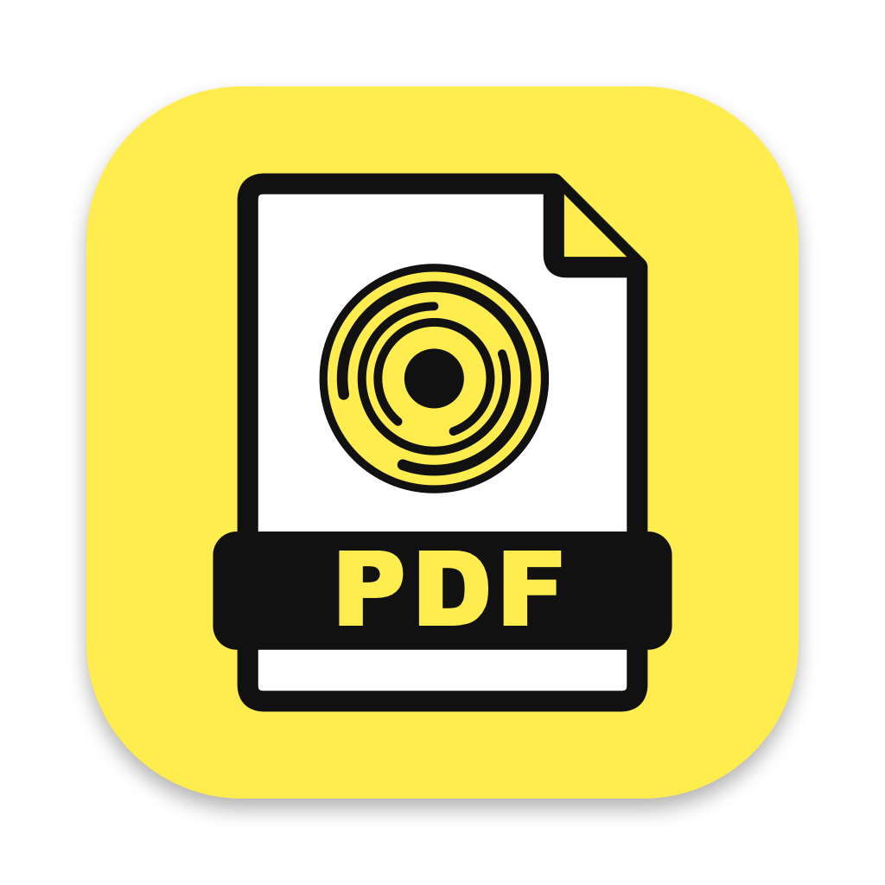

<p align="center">
  
</p>

<h1 align="center">PDF Gremza</h1>

<p align="center">
  A simple, fast and free PDF viewer for macOS and Windows.
</p>

<p align="center">
  <a href="https://gremza.github.io/pdf-reader-free/"><b>Website & downloads</b></a> ·
  <a href="../../releases/latest">Latest release</a>
</p>

---

## Features

- **Tabs in the top bar** — open many PDFs side by side; tabs that don't fit go into a `»` overflow menu
- **Page thumbnails** sidebar — drag to reorder pages, right-click for page actions, `Delete` removes a page
- **Zoom**: zoom in/out, fit width, fit whole page, actual size (100%)
- **Layouts**: single page, continuous, two pages, two pages continuous
- **Rotate** pages left / right
- **Full Screen Mode** — only the page, on black, without bars or borders; turn pages like a presentation with the arrow keys, `Space`, `Page Up` / `Page Down` or a click (right-click goes back); `Esc` exits
- **Search** text inside the document
- **Edit pages**: delete, rotate, insert blank pages, insert pages from other PDFs, merge PDFs, with undo
- **Save / Save As** — changes are only written when you save; unsaved tabs show `●` and ask before closing
- **Extract pages** (e.g. `1-3, 5`) into a new PDF, or **split** every page into its own PDF
- **Export to Word** (`.docx`) — the text of the PDF, with paragraphs, bold/italic and font sizes
- **Export to JPG** — saves every page as an image (`1.jpg`, `2.jpg`, …) in a new folder named after the PDF
- **Updates** — checks GitHub for a new version at launch and once a day; installs it automatically or asks first (*Check for Updates…*, *Check for Updates Automatically*, *Install Updates Automatically* in the app menu on macOS and the **Updates** button on Windows)
- **Keyboard shortcuts like Adobe Acrobat Reader**, shown next to the menu items
- On macOS every action is also in the menu bar (File, Edit, View, Pages)
- Open via `⌘O`, drag & drop, the Dock icon, or Finder's *Open With*
- No tracking, no accounts; the only network access is the update check (it can be turned off)

The macOS app is native (SwiftUI + PDFKit); the Windows app is built with Electron and [pdf.js](https://mozilla.github.io/pdf.js/) and has the same features.

## Keyboard shortcuts

The same as in Adobe Acrobat Reader.

| Action | macOS | Windows |
|---|---|---|
| Open PDF(s) | `⌘O` | `Ctrl+O` |
| Close tab | `⌘W` | `Ctrl+W` |
| Next / previous tab | `⌘⇧]` / `⌘⇧[` | `Ctrl+Tab` / `Ctrl+Shift+Tab` |
| Next / previous page | `→` / `←` | `→` / `←` (or `Ctrl+Page Down` / `Ctrl+Page Up`) |
| First / last page | `Home` / `End` | `Home` / `End` |
| Go to page | `⌘⇧N` | `Ctrl+Shift+N` |
| Zoom in / out | `⌘=` / `⌘−` | `Ctrl+=` / `Ctrl+−` (or `Ctrl` + mouse wheel) |
| Actual size | `⌘1` | `Ctrl+1` |
| Fit page / fit width | `⌘0` / `⌘2` | `Ctrl+0` / `Ctrl+2` |
| Rotate left / right | `⌘⇧−` / `⌘⇧=` | `Ctrl+Shift+−` / `Ctrl+Shift+=` |
| Full Screen Mode | `⌘L` | `Ctrl+L` (or `F11`) |
| Show / hide thumbnails | `F4` | `F4` |
| Search | `⌘F` | `Ctrl+F` |
| Find next / previous | `⌘G` / `⌘⇧G` | `Ctrl+G` / `Ctrl+Shift+G` (or `F3` / `Shift+F3`) |
| Insert pages from PDF | `⌘⇧I` | `Ctrl+Shift+I` |
| Delete page | `⌘⇧D` | `Ctrl+Shift+D` |
| Export pages to JPG | `⌘E` | `Ctrl+E` |
| Save / Save As | `⌘S` / `⌘⇧S` | `Ctrl+S` / `Ctrl+Shift+S` |
| Undo | `⌘Z` | `Ctrl+Z` |

In Full Screen Mode: `→` `↓` `Space` `Page Down` `Enter` or a click for the next page, `←` `↑` `Shift+Space` `Page Up` `Backspace` or a right-click for the previous one, `Home` / `End` for the first / last page, `Esc` to exit.

## Install

### macOS

Grab `PDF-Reader.zip` from the [latest release](../../releases/latest), unzip it and move **PDF Gremza.app** to `/Applications`.

The app is not notarized by Apple, so the first time macOS will block it. Right-click the app → **Open** → **Open** (or allow it in *System Settings → Privacy & Security*). After that it opens normally.

### Windows

Grab `PDF-Reader-Setup-<version>-x64.exe` from the [latest release](../../releases/latest) and run it (or use `PDF-Reader-Portable-<version>-x64.exe`, which runs without installing). The installer registers PDF Gremza under *Open with* for `.pdf` files.

The app is not code-signed, so Windows SmartScreen may warn the first time: click **More info** → **Run anyway**.

### Build from source (macOS)

Requires macOS 14+ and Xcode 15+ (or the Swift toolchain).

```sh
git clone https://github.com/Gremza/pdf-reader-free.git
cd pdf-reader-free
./build.sh
```

`build.sh` compiles a release build, creates `build/PDF Gremza.app` and copies it to `/Applications`.

The logo is `Resources/AppIcon.svg`. After changing it, regenerate the macOS, Windows and website icons with `swift Tools/make_icon.swift`

### Build from source (Windows)

Requires Node.js 20+. Works on Windows, macOS or Linux.

```sh
cd windows
npm install
npm start            # run in development
npm run dist         # build the x64 installer + portable exe into windows/dist/
npm run dist:arm64   # same for Windows on ARM
```

## Project structure

```
Sources/PDFReader/
  PDFReaderApp.swift   App entry, file opening, quit confirmation
  MenuCommands.swift   File / Edit / View / Pages menu bar items
  TabsModel.swift      Open documents / tabs, unsaved-changes prompts
  TopBar.swift         Tab strip with overflow + toolbar controls
  ContentView.swift    Window layout, empty state, drag & drop
  PDFViewModel.swift   Navigation, zoom, layouts, search, page edits, undo, save, export
  ThumbnailSidebar.swift  Thumbnails: reorder by drag, page context menu
  WordExport.swift     PDF text → paragraphs → .docx
  PDFKitViews.swift    PDFView wrapper
  WindowChrome.swift   Hidden title bar, traffic light positioning
Resources/             Info.plist, app icon
Tools/make_icon.swift  Makes every app icon from Resources/AppIcon.svg

windows/src/
  main.js              Electron main process: window, file opening, single instance
  preload.js           Bridge between the window and the main process
  index.html           Top bar, empty state
  renderer.js          Tabs, navigation, zoom, layouts, rotation, search, thumbnails
  styles.css           Light / dark theme
```

## Contributing

Issues and pull requests are welcome.

## License

[MIT](LICENSE) © 2026 Marsel Preci
